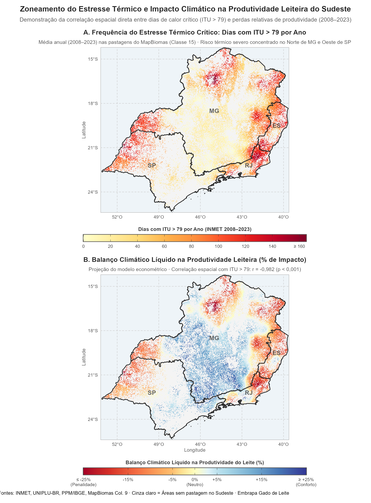

::: {.callout-note}
## 🎯 Objetivo deste Relatório
Este material foi estruturado para apresentar ao orientador (e servir como roteiro visual para a gravação em vídeo) a fundamentação matemática, a lógica de escala e o comportamento espacial da **Equação 3** — responsável por gerar o mapa de **Balanço Climático Líquido ($\Delta\%_{\text{líquido}}$)** nas pastagens do Sudeste brasileiro.

O processamento computacional de álgebra de mapas é 100% implementado em **Python** (`numpy` e `rasterio`), integrando dados meteorológicos do **INMET**, precipitação do **UNIPLU-BR**, produção do **IBGE (PPM 2008–2023)** e máscara de pastagem da **Coleção 9 do MapBiomas** (33.640 células a ~3 km de resolução).
:::

---

# A Equação Estrutural do Raster (Equação 3)

Para você dominar a matemática e explicar com total segurança para o seu orientador, vamos dissecar a **Equação 3** passo a passo:

$$\Delta\%_{\text{líquido}}(x) = \left(\exp\Big(\beta_{\text{calor}}\cdot(R_{\text{ITU}}(x)-\overline{\text{ITU}}) + \beta_{\text{chuva}}\cdot(R_{\text{Chuva}}(x)-\overline{\text{Chuva}})\Big) - 1\right)\times 100$$

::: {.callout-tip collapse="true"}
## 🎙️ Dica para a Gravação do Vídeo (Abertura da Equação)
> *"Professor, esta equação é o coração da nossa álgebra de mapas. Ela pega a inclinação econométrica dos coeficientes de calor e chuva e traduz diretamente cada pixel em um valor percentual comparativo com a média regional do Sudeste."*
:::

---

# 1. De onde vem a estrutura matemática? (A lógica do Log-Linear)

O modelo estatístico original estimado em painel de efeitos fixos municipais é uma regressão com a variável dependente em logaritmo:

$$\log(Y) = \alpha + \beta_{\text{calor}} \cdot \text{ITU} + \beta_{\text{chuva}} \cdot \text{Chuva} + \dots$$

Quando variamos as variáveis explicativas em $\Delta \text{ITU}$ e $\Delta \text{Chuva}$, a variação esperada no log da produtividade é dada pela diferença entre o valor local e a referência média:

$$\Delta \log(Y) = \log(Y_{\text{local}}) - \log(Y_{\text{médio}}) = \log\left(\frac{Y_{\text{local}}}{Y_{\text{médio}}}\right)$$

Pela propriedade exponencial inversa da função logarítmica:

$$\frac{Y_{\text{local}}}{Y_{\text{médio}}} = \exp(\Delta \log(Y))$$

A variação percentual relativa ($\Delta\%$) de qualquer grandeza física em relação a uma referência é calculada por:

$$\Delta\% = \left(\frac{Y_{\text{local}} - Y_{\text{médio}}}{Y_{\text{médio}}}\right) \times 100 = \left(\frac{Y_{\text{local}}}{Y_{\text{médio}}} - 1\right) \times 100$$

Substituindo a razão exponencial na fórmula da variação percentual:

$$\Delta\% = \big(\exp(\Delta \log(Y)) - 1\big) \times 100$$

É exatamente daí que surge a expressão aplicada pixel a pixel na matriz do raster.

::: {.callout-important}
## 💡 Ponto-chave para explicar ao Orientador
Na econometria, o modelo log-linear mede **semi-elasticidades**. A transformação $\big(\exp(\Delta \log(Y)) - 1\big) \times 100$ é a correção exata (Halvorsen-Palmquist / Kennedy) para transformar a soma linear ponderada dos coeficientes em variação percentual real e não linear sobre o produto.
:::

---

# 2. O que significa "centrar na média regional"?

Repare nos dois termos de desvio dentro do expoente:

$$(R_{\text{ITU}}(x) - \overline{\text{ITU}}) \quad \text{e} \quad (R_{\text{Chuva}}(x) - \overline{\text{Chuva}})$$

Onde:

* **$R_{\text{ITU}}(x)$**: é a frequência crítica de calor (dias com $\text{ITU} > 79$) naquela célula/pixel específica $x$.
* **$\overline{\text{ITU}}$**: é a **média de calor de todas as pastagens do Sudeste** ($\approx 52\text{ dias/ano}$).
* **$R_{\text{Chuva}}(x)$**: é a precipitação anual acumulada naquela célula específica $x$.
* **$\overline{\text{Chuva}}$**: é a **média pluviométrica de todas as pastagens do Sudeste** ($\approx 1.340\text{ mm/ano}$).

### Por que fazer essa subtração?

Se não subtraíssemos a média, o raster mostraria a diferença em relação a um cenário hipotético de *"zero dias de calor e zero chuva acumulada"* — o que não existe na natureza e distorceria qualquer interpretação agronômica. 

Ao subtrair a média regional:

1. **A referência é o clima real da região:** Uma fazenda que experimenta exatamente a média regional de calor e a média de chuva terá desvios nulos:
   $$\Delta \log(Y) = \beta_{\text{calor}}\cdot 0 + \beta_{\text{chuva}}\cdot 0 = 0 \implies \exp(0) - 1 = 0\%$$

2. **$0\%$ significa neutralidade:** Representa rigorosamente a média bioclimática das pastagens do Sudeste.
3. **Valores positivos ($>0\%$):** Indicam **vantagens climáticas** (refúgio térmico ou maior disponibilidade hídrica) em relação à média regional.
4. **Valores negativos ($<0\%$):** Indicam **penalidades climáticas líquidas** em relação ao padrão do Sudeste.

---

# 3. As Escalas e as Ordens de Grandeza (Os Coeficientes $\beta$)

Observe a magnitude dos coeficientes estruturais estimados no modelo econométrico (Nota Técnica):

| Fator Climático | Coeficiente ($\beta$) | Erro-Padrão / Significância | Unidade da Variável |
| :--- | :---: | :---: | :--- |
| **Estresse Térmico (Calor)** | $\beta_{\text{calor}} = -0,00282$ | $t = -4,17 \quad (p < 0,001)$ | Dias/ano com $\text{ITU} > 79$ |
| **Disponibilidade Hídrica (Chuva)** | $\beta_{\text{chuva}} = +0,000117$ | $t = +2,13 \quad (p < 0,05)$ | $\text{mm/ano}$ acumulados |

À primeira vista, parece que o efeito do calor é muito maior do que o da chuva porque $|-0,00282| > 0,000117$. Mas aqui entra a **escala das grandezas físicas**:

### A. A Escala do Calor ($R_{\text{ITU}}$)

* **Unidade:** Dias no ano com Índice de Temperatura e Umidade crítico ($\text{ITU} > 79$).
* **Faixa de variação:** Varia de cerca de $0$ dias/ano (nas montanhas do Sul de MG e Mantiqueira) até mais de $160$ dias/ano (no Norte de MG e Noroeste de SP). A amplitude regional é de cerca de $150$ dias.
* **Impacto isolado no expoente:**
  Se um local tem $50$ dias a mais de estresse térmico que a média regional ($\Delta \text{ITU} = +50$):
  $$\Delta \text{expoente}_{\text{calor}} = -0,00282 \times (+50) = -0,141$$
  $$\exp(-0,141) - 1 \approx -13,1\%$$

### B. A Escala da Chuva ($R_{\text{Chuva}}$)

* **Unidade:** Milímetros de chuva acumulada ao ano ($\text{mm/ano}$).
* **Faixa de variação:** No Sudeste, a precipitação anual varia tipicamente de $\approx 800\text{ mm}$ (semiárido/Norte mineiro) até $\approx 2.000\text{ mm}$ (zonas serranas e litoral), gerando desvios em relação à média de $\pm 500\text{ mm}$ ou mais.
* **Impacto isolado no expoente:**
  Se um local recebe $500\text{ mm}$ a mais de chuva que a média regional ($\Delta \text{Chuva} = +500$):
  $$\Delta \text{expoente}_{\text{chuva}} = +0,000117 \times (+500) = +0,0585$$
  $$\exp(+0,0585) - 1 \approx +6,0\%$$

::: {.callout-note}
## ⚖️ Conclusão sobre as escalas físicas
O coeficiente $\beta_{\text{chuva}}$ é menor na quarta casa decimal porque ele é multiplicado por centenas de milímetros, enquanto $\beta_{\text{calor}}$ multiplica dezenas de dias. Contudo, como o estresse térmico exerce forte peso biológico sobre o gado leiteiro, **nas regiões tórridas a penalidade do calor supera com folga o alívio que a chuva possa fornecer**.
:::

---

# 4. Como esse cálculo se comporta na prática (Dois exemplos reais)

Para mostrar ao seu orientador como o pixel adquire sua tonalidade no mapa e no QGIS, analisemos dois locais contrastantes do Sudeste:

{#fig-zoneamento width=85% fig-align="center"}

::: {.scenario-grid}

::: {.scenario-card .scenario-red}
#### 🔴 Cenário 1: Norte de Minas Gerais
**Região de Penalidade Severa (Tom Vermelho no Mapa)**

* **Condições Climáticas:**
  * $\Delta \text{ITU} = +70\text{ dias}$ acima da média regional
  * $\Delta \text{Chuva} = -300\text{ mm}$ abaixo da média regional
* **Cálculo da variação do log:**
  $$\Delta \log(Y) = (-0,00282 \times 70) + (0,000117 \times (-300))$$
  $$\Delta \log(Y) = -0,1974 - 0,0351 = -0,2325$$
* **Impacto Percentual Final:**
  $$\Delta\% = (\exp(-0,2325) - 1) \times 100 \approx -20,75\%$$
* **Resultado Cartográfico:** Como o valor é de **$\approx -21\%$**, o pixel recebe tonalidade vermelha intensa (forte penalidade climática sobre o rendimento das vacas).
:::

::: {.scenario-card .scenario-blue}
#### 🔵 Cenário 2: Sul de Minas / Mantiqueira
**Região de Refúgio Térmico (Tom Azul no Mapa)**

* **Condições Climáticas:**
  * $\Delta \text{ITU} = -40\text{ dias}$ (praticamente isento de calor crítico)
  * $\Delta \text{Chuva} = +200\text{ mm}$ acima da média regional
* **Cálculo da variação do log:**
  $$\Delta \log(Y) = (-0,00282 \times (-40)) + (0,000117 \times 200)$$
  $$\Delta \log(Y) = +0,1128 + 0,0234 = +0,1362$$
* **Impacto Percentual Final:**
  $$\Delta\% = (\exp(0,1362) - 1) \times 100 \approx +14,59\%$$
* **Resultado Cartográfico:** Como o valor é **$+14,6\%$**, o pixel fica destacado em azul (vantagem produtiva decorrente do conforto bioclimático).
:::

:::

---

# 4.1 Implementação Vetorizada em Python

No ambiente de pesquisa, o cálculo da Equação 3 é executado em matrizes contínuas com **Python** (`numpy` e `rasterio`). O código opera diretamente sobre as células mascaradas de pastagem:

```python
import numpy as np
import rasterio

# Parâmetros estruturais estimados no modelo econométrico
BETA_CALOR = -0.00282
BETA_CHUVA = +0.000117

# Leitura das matrizes raster
with rasterio.open("itu_inmet_anual_3km.tif") as src_itu, \
     rasterio.open("chuva_uniplu_anual.tif") as src_chuva, \
     rasterio.open("mascara_pastagem_mapbiomas.tif") as src_mask:
    
    mat_itu = src_itu.read(1)
    mat_chuva = src_chuva.read(1)
    mask_pastagem = src_mask.read(1) == 15  # Classe 15: Pastagem

# Validação de dados finitos sobre as pastagens
valid = mask_pastagem & np.isfinite(mat_itu) & np.isfinite(mat_chuva)

# Cálculo centrado na média das pastagens do Sudeste
media_itu = np.mean(mat_itu[valid])
media_chuva = np.mean(mat_chuva[valid])

# Variação do log (Equação 3)
d_log = (BETA_CALOR * (mat_itu[valid] - media_itu)) + \
        (BETA_CHUVA * (mat_chuva[valid] - media_chuva))

# Conversão exponencial para taxa percentual (%)
liq_pct = np.full(mat_itu.shape, np.nan, dtype=np.float32)
liq_pct[valid] = (np.exp(d_log) - 1.0) * 100.0

print(f"Balanço Climático Médio: {np.mean(liq_pct[valid]):.2f}%")
```

---

# 5. Resumo em 3 Frases para dizer ao seu Orientador

Ao gravar seu vídeo ou conduzir sua reunião de orientação, use este roteiro conciso para sintetizar todo o trabalho:

::: {.summary-sentence}
**1.** *"Cada pixel deste raster é o resultado de uma função exponencial que converte a elasticidade do modelo econométrico numa taxa percentual direta."*
:::

::: {.summary-sentence}
**2.** *"O zero da escala representa o clima médio do Sudeste: pixels azuis têm clima mais favorável à produção de leite que a média regional, e pixels vermelhos sofrem penalidade líquida."*
:::

::: {.summary-sentence}
**3.** *"O modelo pondera os dois fatores simultaneamente: cada dia a mais de estresse térmico drena cerca de 0,28% da produtividade diária por vaca, enquanto a disponibilidade hídrica atua como amenizadora."*
:::

::: {.callout-tip collapse="true"}
## 🎬 Sugestão de Fechamento do Vídeo
> *"Professor, com essa formulação conseguimos transpor um modelo econométrico de painel para uma matriz geográfica contínua de alta precisão. Na próxima etapa, aplicamos essa taxa sobre a produtividade base municipal para quantificar a perda física real em litros de leite por vaca ao ano."*
:::
